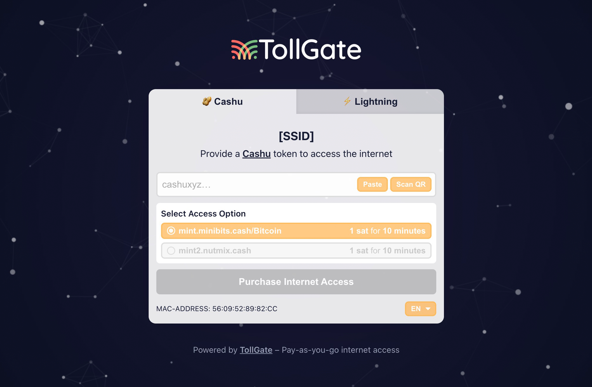

# Tollgate Captive Portal



A captive portal website for [Tollgate](https://tollgate.me). This portal allows users to paste a Cashu token or pay with BTC Lightning to gain internet access.

## Features

- Pay with Cashu Token
- Pay with BTC Lightning
- Check your internet balance (a dedicated "Balance" tab shows how much internet access — time or data — a Cashu token grants before you pay)

## Owner Wi-Fi setup

In the router's owner admin, select **Connect to venue Wi-Fi** on Home. Choose
an available network and enter its password. The existing upstream connection
service selects the radio; reported bands are shown as 2.4 GHz, 5 GHz or 6 GHz.
Radio and interface editing remains under **Advanced Wi-Fi settings**.

The **Internet source** card uses the router's internet check, separately from
the Wi-Fi join result. A selected saved network does not by itself confirm
internet access. Use **Check internet** to refresh the result. If a venue
requires a browser sign-in, complete it on a device using TollGate for internet
and check again; the admin does not automatically sign into venue portals.

## Profit Share controls

Open **Settings → Profit Share** in the owner admin to edit existing Lightning
destinations and saved percentages. Sliders redistribute other shares to keep
the total at 100%; number fields allow exact edits. Review each destination
save separately from an allocation save because they take effect at different
times. Existing recipient names and signing keys are preserved.

Destination changes are selected by a subsequent payout pass; an in-progress
payout may keep the previous address. Saved percentages load at service startup.
Use **Restart TollGate to apply** and read its confirmation: restarting ends
active paid sessions, and guests may need to pay again. **Check service status**
is read-only. An unknown restart outcome is never retried automatically.

The restart control requires the matching management plugin and authenticated
write ACL. Older plugins leave it disabled. An uncertain save can already have
changed the router's in-memory settings; the editor re-reads them and reports
uncertainty rather than promising a rollback. Changes are checked against fresh
reads, but the existing backend does not provide atomic compare-and-swap for
concurrent administrators.

## Contributing

### Internationalization (i18n)

Add a new `[language_code]` to the `supportedLanguages` array in [`./src/helpers/i18n.js`](./src/helpers/i18n.js)

Create `[language_code].json` file in [`./public/locales/`](./public/locales/) folder and follow the structure of [`./public/locales/en.json`](./public/locales/en.json).

---

### Development

- Node.js (v22.17.0 or later)
- npm (v10.9.2 or later)

#### Installation

1. Clone the repository
```bash
git clone <repository-url>
cd tollgate-captive-portal-site
```

2. Install dependencies
```bash
npm install
```

3. Start the development server
```bash
npm run dev
```

#### Configuration

To configure the Nostr relay address and other settings, modify the relevant variables in the [`tollgate.js`](./src/helpers/tollgate.js) file.

The hardcoded mock data (used for development) should be updated regularly to match the latest [TollGate protocol tip01 example](https://github.com/OpenTollGate/tollgate/blob/main/protocol/01.md). This ensures development and testing reflect the current protocol.

---

### Error Codes

#### TollGate Error Codes

| Code   | Use-Case Description |
|--------|---------------------|
| `TG001` | Triggered when the app fails to fetch TollGate details from the backend (e.g., network/server error on the main details endpoint). |
| `TG002` | Triggered when the app fails to fetch device information (such as MAC address) from the backend. |
| `TG003` | Triggered when there is a general error fetching TollGate data, such as a network failure or the relay is unreachable. |
| `TG004` | Triggered when the app cannot extract or parse pricing information from the TollGate details event (e.g., missing or malformed pricing tags). |

#### Cashu Error Codes

| Code   | Use-Case Description |
|--------|---------------------|
| `CU001` | Triggered when no valid access options are available for the user (e.g., no valid mints or pricing options found in the TollGate event). |
| `CU002` | Triggered when the provided Cashu token does not contain enough funds for the selected mint or access option. |
| `CU100` | Triggered when the user submits an empty or missing token. |
| `CU101` | Triggered when the provided token does not start with "cashu" (invalid format). |
| `CU102` | Triggered when the token cannot be decoded (malformed or corrupted token). |
| `CU103` | Triggered when the token is decoded but contains no proofs (i.e., no spendable value). |
| `CU104` | Triggered when there is a general error during token validation or decoding (unexpected error). |
| `CU105` | Triggered when the app fails to generate cryptographic keys needed to sign the payment event (client-side cryptography error). |
| `CU106` | Triggered when the backend (TollGate) rejects the token with a 402 (payment required) response, meaning the token was not accepted. |
| `CU107` | Triggered when the backend returns a general server error (not 402) during token submission. |
| `CU108` | Triggered when there is a client-side error sending the token to the backend (e.g., network failure or unexpected error during submission). |
| `CU109` | Triggered when the backend returns a DLEQ keyset-rotation error (kind 21023, code `payment-error-dleq-keyset-rotation`), meaning the mint rotated its security keys since the token was created and the e-cash note is no longer spendable. |

#### Lightning Error Codes

| Code   | Use-Case Description |
|--------|---------------------|
| `LN001` | Triggered when no valid access options are available for Lightning payments (e.g., no valid mints or pricing options found). |
| `LN002` | Triggered when the user-specified amount is not enough to purchase access from the selected mint. |

#### Clipboard Error Codes

| Code   | Use-Case Description |
|--------|---------------------|
| `CB001` | Triggered when the browser denies permission to read from the clipboard (user did not grant access). |
| `CB002` | Triggered when reading from the clipboard fails for any other reason (e.g., clipboard is empty, or an unexpected error occurs). |

#### QR Code Error Codes

| Code   | Use-Case Description |
|--------|---------------------|
| `QR001` | Triggered when the browser denies permission to access the camera for QR scanning. |
| `QR002` | Triggered when the app fails to read a QR code from the camera (e.g., camera error, no QR code detected, or scan interrupted). |
| `QR003` | Triggered when the user uploads an image but no QR code is found in the selected image. |
| `QR004` | Triggered when there is a general camera error (e.g., no camera present, or the page does not have permission to use it). |

---

### Discussion Topics

- [ ] **Handle exotic units in access options sorting**  
  The code currently sorts access options by price per step, assuming all units are directly comparable (e.g., all in 'sat'). If a new or exotic unit appears (not 'sat'), the comparison may be invalid. Logic should be added to handle and compare different units safely.

- [ ] **Check if token unit matches mint unit**  
  When validating a Cashu token, the code should verify that the unit of the token matches the unit expected by the selected mint (e.g., both are 'sat'). If they do not match, the user should be shown an appropriate error.

- [ ] **Status and open questions for Lightning implementation**  
  The Lightning payment flow currently uses a placeholder invoice is not fully integrated. What are the next steps for a production-ready Lightning integration?

- [ ] **Captive portals may restrict camera or clipboard permissions**  
  Captive portals often run in restricted network environments, which may prevent browsers from granting camera or clipboard permissions—even if the portal is served over HTTPS. How should the app handle or communicate these limitations to users, and what are possible workarounds or fallback strategies?

- [ ] **Surface the balance page in a first-run config wizard**  
  The Balance page (`src/components/BalancePage.jsx`) is currently reachable as a standalone tab. It is intentionally self-contained (it only needs `tollgateDetails` and an optional `onNavigate` callback) so it can be reused as a step in a future first-run configuration wizard. When such a wizard is designed, decide where the balance check should sit in the flow and whether it should pre-fill from a detected/stored token.

### Gateway objective picker

The picker stays completely hidden until the merchant API on `http://<portal-host>:2121`
serves `GET /api/multi_wan/objectives` with
`{enabled:true, allow_change:"next_session"|"never", current:"<id>", objectives:[{id,label,summary?}]}`.
IDs must be unique, labels nonempty strings, and `current` must name an offered ID.
404, a 4-second timeout, disabled capability or malformed JSON produces no UI.
`never` shows disabled options with the next-session explanation; all changes are
labelled **Use for next session**, never an immediate switch. English copy lives in
`public/locales/en.json` (served as `/locales/en.json`).

No backend implements this endpoint yet. The write contract is **proposed, not a
verified backend capability**: `POST` to the same path with `{"objective":"<id>"}`,
2xx acknowledging storage for the next session. Errors never report success;
404/405/501 disable further choices and show unavailable. The backend must implement
both methods before enabling this capability. Current-session routing is never changed
by the portal. Unit and browser coverage: `gateway-objective-picker.test.jsx` and
`gateway-objectives.spec.mjs`.

### License

This project is licensed under the GPLv3 License.


## cashu-ts dependency policy (2026-09-05)

Pin here: `@cashu/cashu-ts ^2.2.2`. Before ANY major bump (4→5; also applies
to any 2/3→4 straggler work): read the upstream migration guide for the
target major — https://github.com/cashubtc/cashu-ts/blob/main/migration-X.0.0.md
— AND the agent-oriented step-by-step skill shipped INSIDE the package
(`node_modules/@cashu/cashu-ts/migration-X.0.0.SKILL.md`) AND the release
notes. v4 break classes that already cost Amperstrand sessions: Amount
value objects (JSON.stringify emits decimal STRINGS — wire/DB amounts stay
plain integers; convert only at library boundaries), ESM-only,
getDecodedToken requires keysetids (guard #1084), melt-change strictness =
fund-loss class on paid melts (fixed upstream #1081; v4 backport #1083
pending release as of 2026-09-05 — 4.10.1 does NOT contain it). v5 is at
RC — expect migration-5.0.0.md before any 5.x adoption. Details:
hackathon-tooling patterns/cashu/client-gotchas.md.


### Owner administration coverage

The admin has a **Maintenance** page for service start/stop/restart, diagnostics
and private-network controls. Every service action has a separate review. Stop
prevents new purchases; restarting ends active paid sessions and guests may need
to pay again. The page distinguishes a completed command from a responding API.
Status/health do not establish purchase readiness or the running payout allocation.
Lost or failed mutation replies stay uncertain and are never retried automatically.

| Owner task | Dashboard workflow |
| --- | --- |
| Connect to venue Wi-Fi; saved uplinks; radio settings | WiFi |
| Pricing, accepted mints, payout intervals and thresholds | Settings, with step units and pricing preview |
| Existing payout addresses and allocation | Settings → Profit Share; explicit review, separate apply timing |
| Private SSID, password, encryption and admin-access scope | Settings; secret fields remain write-only |
| Private Wi-Fi on/off | Maintenance; wired management acknowledgement and wireless-interruption review |
| Pin management IPv4 address | Maintenance; usable host on /24, review/reconnect guidance; requires CLI support |
| Root password and persisted hostname | Settings; password uses root username and shared policy; hostname readback distinguishes stored from active |
| Start, stop, restart and diagnostic facts | Maintenance; authenticated fixed RPC methods |
| Balance, funding, withdrawal and connected DHCP clients | Wallet and Devices; failed reads show unavailable |
| Firmware, backups, reboot, firewall, DHCP, full logs, advanced HTTPS | Maintenance → router-reported HTTPS LuCI link; settings remain in LuCI |

Private metadata reads only address and configured interface enablement. It never
forwards `network private status`, whose CLI response contains the Wi-Fi password.
Address pinning calls `network private set-address` so both the interface and
TollGate’s durable setup store change together. A completed save may still need
a network reload; it does not prove that the new address is reachable.

The schema editor supports strings, numeric bounds, exact integer values,
booleans, nested objects, object lists, primitive lists and durations (shown in
seconds, stored as numeric nanoseconds). Empty lists remain `[]`; read-only
parents lock their children. Containers without item/field metadata display
read-only JSON so editing cannot silently convert their types. Validation checks
changed leaves, preserving untouched legacy values. Secret fields are cleared
recursively after saving and are not replayed by a later form save.

Signing keys, seed recovery, creating new public payout identities, TollGate TLS
apply/remove and wholesale identity replacement still need dedicated protected
workflows. They are visible as specialist operations in Maintenance, not exposed
as a shell or arbitrary file editor. LuCI certificate editing does not implement
TollGate’s persistent TLS opt-out semantics. Saved upstream history and manual
configuration convergence remain specialist CLI operations; the existing WiFi
page manages configured uplinks. No sales-pause command exists in the audited
runtime: `manual_pause_seconds` pauses upstream scanning.


### Ethernet-first internet with venue Wi-Fi backup

The Home/WiFi Internet source card separates **Preferred: Ethernet WAN**,
**Backup: venue Wi-Fi**, independent health, and the applied route for new
connections. The owner can review enabling or disabling automatic fallback in
the card. Status refreshes without overlapping requests; failed reads clear
readiness claims. Existing connections can keep their previous uplink until they
reconnect. Changing public IP can interrupt connections; this is not MPTCP.

IPv4 prefers healthy WAN, falls back to healthy WWAN, and returns after stable
recovery. Wi-Fi fallback uses IPv4. IPv6 uses checked WAN6 or is blocked when no
healthy WAN6 exists; this implementation does not promise cross-provider IPv6
prefix translation. Both families are shown separately.

The fixed profile uses the official OpenWrt mwan3 2.12 engine, with a narrowly
reviewed tracker extension and a static Go DNS/HTTP probe. The router's existing
iptables-nft compatibility stack is required; this is not the unofficial native
nftables mwan3 fork. Do not equate the runtime's experimental multi_wan config
with this working controller. Its objective renderer remains separate.

Each probe binds DNS and HTTP to the tested interface, source address and bypass
mark. It uses that interface's usable advertised DNS servers; public resolvers
are fallback only when none are advertised. Two fixed HTTP endpoints must return
204 without a body or redirect; either can satisfy a round. A four-second probe
budget, five-second intervals and three down/up thresholds bound attempts and
reduce flapping. Probe time adds to the interval; exact fifteen-second handover
is not guaranteed. Global network_ok, association and ICMP alone do not establish
backup readiness.

Installation and command contracts:

- [Probe source/build](openwrt/failover-probe/README.md): build for the actual router
  architecture and install as /usr/libexec/tollgate/uplink-probe.
- [Profile/controller](openwrt/failover/README.md): install the signed official
  dependencies, preserve existing routing ownership, place the disabled owned
  template before first package installation, and install the fixed controller.
- Use packaging/patch-mwan3-track.py only with a freshly reviewed original tracker
  SHA-256; it refuses unknown layouts/hashes and never weakens a missing HTTP
  probe to ping. Do not overwrite another routing controller's configuration.
- The driver changes only its owned profile and engine lifecycle, never ordinary
  network configuration. Existing WAN/WWAN main metrics must already be distinct
  (an unset metric counts as zero); use LuCI's interface routing settings if this
  prerequisite is not met. Member priorities select Ethernet regardless of which
  ordinary main metric is lower. Disable returns to unchanged ordinary routing.
- internet_policy_get is authenticated read access; internet_policy_set takes a
  real Boolean enabled and is authenticated write access. No interface, URL,
  command, key or file path comes from the caller. Unknown outcomes never retry.

Preserve the controller's root-only recovery receipts. The exact tracker marker,
owned profile hash, PBR/bonding conflicts, reserved packet marks, low routing
tables and verified native IPv6 guards are checked. Applied policy is read from
engine/kernel evidence, never guessed from main-route metrics; a missing empty
policy RPC key needs independent kernel unreachable evidence.

Disable this feature before firmware or mwan3 package upgrades, then requalify
the tracker integration before enabling it again. A stock tracker replacement
invalidates support. If its helpers are damaged, use LuCI System → Startup to
stop/disable mwan3 and recover ordinary routing; do not restore an entire old
network configuration over unrelated edits. This source contribution does not
provide an automatic firmware-upgrade migration.

For venue sign-in, use the card's **Prepare Wi-Fi backup at a venue** help. With
health-based routing active, unverified paths are blocked; temporarily disable
fallback and unplug WAN, then sign in through a device actually using TollGate's
private network for internet. Reconnect WAN and re-enable once setup is complete.
This does not automatically log into arbitrary venue captive portals.

Tests cover bound probe behavior, controller ownership/partial errors, RPC
permissions and UI state/review flows. Kernel and hardware acceptance, an actual
WAN cable/outage/recovery cycle, venue login and IPv6 delegation remain separate
from command-fixture/browser tests. No engine action explicitly restarts
TollGate, NoDogSplash or firewall/netifd, and no conntrack flush is performed.
